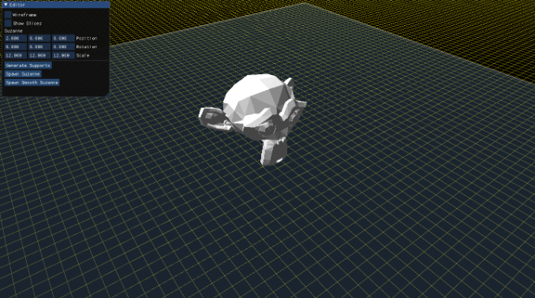
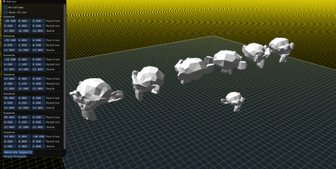
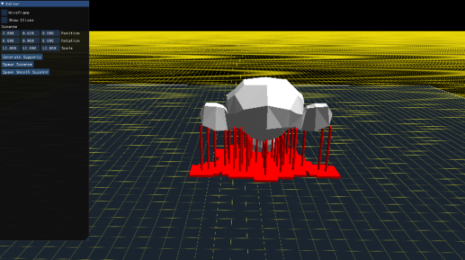
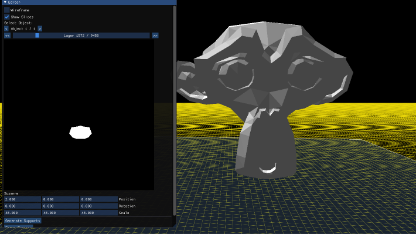

# 3D Printing Slicer
**Personal Software Development Project**
**1. Project Overview**
This project is a custom 3D printing slicer developed in C++ using OpenGL. The application
provides a complete workflow for preparing 3D models for resin 3D printing, from model
import and positioning to automatic support generation, layer slicing and final file export.
The main goal of the project has been to develop the core functionality of a slicer from
scratch, focusing on 3D geometry processing, algorithm development, collision detection
and interactive visualization.
The application is built using CMake and integrates several libraries:

● C++: Main programming language.
● OpenGL: 3D rendering and visualization.
● GLFW: Window and input management.
● GLM: Mathematical operations and 3D transformations.
● Dear ImGui: Application interface and user interaction.
● CMake: Build system and project configuration.

**2. Model Import and Scene Management**
The application supports importing 3D models in STL format, handling both binary and ASCII
representations.
It allows you to see the objects in the scene as both regular solids or wireframes to see
internal geometry.
Once imported, models are displayed in an interactive 3D viewport, where their position,
rotation (Radians) and scale can be modified. These transformations allow the user to orient
and position each model relative to the virtual printing plate.
The scene provides a visual representation of the printing area, helping the user prepare the
model before starting the support generation and slicing stages.

**3. Automatic Support Generation**
One of the main technical components of the project is the automatic support generation
system.
The algorithm analyses the geometry of the model to identify areas that require structural
support during the printing process. Based on this analysis, it generates support structures
while attempting to balance several requirements:
● Avoiding insufficient support in critical regions.
● Preventing unnecessary support generation.
● Detecting and avoiding collisions or unwanted intersections with the model.
● Maintaining structural stability throughout the printing process.
This functionality involves working directly with 3D geometry and implementing algorithms to
evaluate candidate support positions and their spatial relationships with the model.
The objective is to produce support structures that provide adequate stability while
minimizing unnecessary material and avoiding geometric conflicts.

**4. Model Slicing and Layer Preview**
After model preparation and support generation, the application processes the geometry to
generate the individual printing layers.
The slicing stage converts the 3D scene into a sequence of 2D layer representations. Each
generated slice can be previewed individually, allowing the user to inspect the resulting
geometry and verify the slicing output before exporting the final file.
This stage connects the 3D geometry processing pipeline with the data required by the
target printing format.

**5. Export and File Generation**
The final stage of the workflow is exporting the generated slices into the .goo file format.
The export functionality follows the official format documentation, organizing the generated
layer data according to the requirements of the target file specification.
This allows the application to produce files intended for use in compatible resin 3D printers,
completing the workflow from importing a 3D model to generating the final printable output.

● Official Documentation: https://github.com/elegooofficial/GOO/blob/main/Goo%20Format%20Spec%20V1.2.pdf

**6. Technical Challenges and Development Focus**
Developing this application has involved working with several areas of software engineering
and computer graphics:
● 3D Geometry Processing: Importing and manipulating mesh data, analysing model
surfaces and processing geometric information.
● Collision Detection: Evaluating spatial relationships between generated support
structures and the original model to avoid unwanted intersections.
● Algorithm Development: Designing and refining automatic support generation and
slicing algorithms.
● 3D Transformations: Managing model positioning, rotation and scaling using
mathematical transformations.
● Graphics Programming: Building an interactive 3D visualization system using
OpenGL.
● Software Architecture: Organizing a multi-component C++ application and
managing its build configuration through CMake.

**7. Project Summary**
This project has been an opportunity to apply my academic background in Computer
Science to a substantial independent software development challenge.
Rather than relying on existing slicing libraries or building a simple interface around an
external tool, I have focused on implementing the main stages of the workflow myself. It has
allowed me to deepen my understanding of C++, computer graphics, computational
geometry and algorithm design while developing an application around one of my personal
interests: 3D printing.

**the suzanne binary I used to test:** https://www.printables.com/model/549995-suzanne-blender-monkey-subdnosubd/files
**the suzanne binary I used to test:** https://es.m.wikipedia.org/wiki/Archivo:Suzanne.stl
